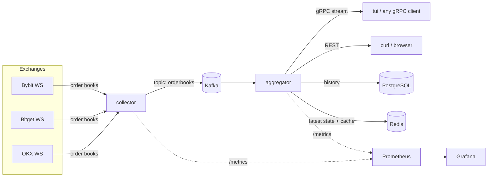

# Crypto Market Data Aggregator

A pet project in Go. The service collects **order books** from three crypto
exchanges (**Bybit, Bitget, OKX**) over WebSocket, converts them to one common
format, and calculates **spreads between exchanges**. Clients get live data
over a **gRPC stream**. The history is saved in **PostgreSQL** and is
available through a **REST API**.

```
◆ Crypto Market Aggregator  ● LIVE  localhost:50051   422 msg/s   exchange→client p50 130ms p99 293ms   server→client p50 1ms
 1 BTC-USDT  2 DOGE-USDT  3 ETH-USDT  4 SOL-USDT  5 XRP-USDT

Best prices
  EXCHANGE            BID     BID SIZE            ASK     ASK SIZE     SPREAD      AGE
  bitget         83530.05       0.4686       83530.06       0.5128   0.00 bps    249ms
  bybit          83522.30       1.3036       83522.40       0.4592   0.01 bps    245ms
  okx            83526.80       0.3891       83526.90       2.2039   0.01 bps   1099ms

Cross-exchange spreads (buy at ask -> sell at bid)
  BUY AT   SELL AT       BUY PRICE     SELL PRICE       SPREAD        BPS       VOLUME      AGE
  bybit    bitget         83522.40       83530.05         7.65     +0.916       0.4592    246ms
  bybit    okx            83522.40       83526.80         4.40     +0.527       0.3891    525ms
  okx      bitget         83526.90       83530.05         3.15     +0.377       0.4686    799ms
  ...
```
*The terminal client with real data (the order book part is cut).*

## Contents

- [Features](#features)
- [Architecture](#architecture)
- [How it works](#how-it-works)
- [Getting started](#getting-started)
- [API](#api)
- [Monitoring](#monitoring)
- [Reconnection](#reconnection)
- [Load testing](#load-testing)
- [Configuration](#configuration)
- [Project structure](#project-structure)
- [Tests](#tests)
- [Design decisions and limits](#design-decisions-and-limits)

## Features

- **3 exchanges** over public WebSocket: Bybit (spot), Bitget (spot), OKX (spot).
  No API keys are needed. It is easy to add a new exchange.
- **Normalization**: one symbol format (`BTC-USDT`), sorted price levels,
  exchange time and receive time in every message.
- **Kafka** between the collector and the aggregator.
- **Spread engine**: spreads for every pair of exchanges, in both directions.
- **gRPC server streaming**: order books and spreads, with filters.
- **REST API**: latest prices and spreads (Redis) and history (PostgreSQL).
- **Prometheus + Grafana**: messages per second, latency, reconnects, spreads.
- **Reconnection** with exponential backoff, ping/pong and dead connection detection.
- **Terminal UI** client (`cmd/tui`).
- **Load test** tool (`cmd/loadtest`).
- Everything starts with one command: `docker compose up`.

## Architecture



| Component | What it does |
|---|---|
| `cmd/collector` | Connects to the exchanges, normalizes order books, writes them to Kafka. |
| `cmd/aggregator` | Reads Kafka, calculates spreads, serves gRPC and REST, saves history. |
| `cmd/tui` | Terminal client. Shows prices, order books and spreads in real time. |
| `cmd/loadtest` | Load test: many gRPC streams + synthetic data in Kafka. |

The collector and the aggregator are separate services. Kafka connects them, so
they can be restarted, deployed and scaled independently. A new consumer of
market data (for example an archive service) can read the same topic without
any changes in the collector.

## How it works

### 1. Collector: WebSocket → normal format

The collector opens **one WebSocket connection per exchange** and subscribes
to the order book channel of every symbol.

| Exchange | Endpoint | Channel | Message type | Levels | Ping |
|---|---|---|---|---|---|
| Bybit | `wss://stream.bybit.com/v5/public/spot` | `orderbook.50.BTCUSDT` | snapshot, then deltas | 50 | `{"op":"ping"}` |
| Bitget | `wss://ws.bitget.com/v2/ws/public` | `books15` | full snapshot every time | 15 | `ping` |
| OKX | `wss://ws.okx.com:8443/ws/v5/public` | `books5` | full snapshot every time | 5 | `ping` |

Every exchange has its own message format, so every exchange has a small
**adapter** (`internal/exchange/<name>`). The adapter only knows the URL, the
subscribe message, the ping message and how to parse a message. All common
logic (connect, keep alive, reconnect, metrics) lives in one place:
`internal/exchange/stream.go`.

Bybit sends a full book only once and then sends **deltas** (changes). The
adapter keeps a local copy of the book: size `"0"` removes a price level,
other sizes add or update it. If the local book becomes "crossed"
(best bid ≥ best ask), it is broken, and the collector reconnects to get a new
snapshot.

The result is the same structure for all exchanges:

```go
type OrderBook struct {
    Exchange   string    // "bybit"
    Symbol     string    // "BTC-USDT" (one format for all exchanges)
    Bids       []Level   // best (highest) first
    Asks       []Level   // best (lowest) first
    ExchangeTS time.Time // event time on the exchange
    ReceivedTS time.Time // when the collector received it
    Seq        int64     // exchange sequence number
}
```

The collector sends the top `BOOK_DEPTH` levels (10 by default) to Kafka.

### 2. Kafka

- Topic `orderbooks`, 6 partitions, data is kept for 1 hour.
- Record key is `exchange:symbol`. All updates of one book go to one
  partition, so their order is kept.
- Value is JSON. It is easy to read with standard Kafka tools.
- The producer is tuned for low latency: `acks=1`, 5 ms linger, LZ4.
- If Kafka is slow or down and the producer buffer is full, new books are
  **dropped** (and counted in a metric). We never block the WebSocket reader:
  old market data has no value anyway.

### 3. Aggregator: spreads

The aggregator reads the topic **from the newest offset without a consumer
group**. After a restart we do not want to replay old prices, and every
aggregator instance needs the full market state to calculate spreads.

For every book the aggregator:

1. Skips it if it is older than `STALE_AFTER` (10 s).
2. Saves it in the **spread engine** (`internal/spread`).
3. Calculates new spreads between this exchange and every other exchange with
   a fresh book of the same symbol:

```
spread     = best_bid(sell_exchange) - best_ask(buy_exchange)
spread_bps = spread / best_ask(buy_exchange) * 10 000
volume     = min(best_ask_size(buy_exchange), best_bid_size(sell_exchange))
```

Example: Bybit ask is 83522.40, Bitget bid is 83530.05. Buy on Bybit and
sell on Bitget: spread = +7.65 USDT = **+0.92 bps** (1 bps = 0.01%).
A positive value means a possible arbitrage window (before fees).

Only pairs with the updated exchange are recalculated: with 3 exchanges one
update gives 4 spreads (2 other exchanges × 2 directions). Books of a
disconnected exchange become stale after 10 seconds and are not used, so
an old price cannot create a fake spread.

4. Sends the book and the spreads to the **gRPC hubs**.
5. Gives the top of the book and the spreads to the **history recorder**.

### 4. gRPC fan-out

The hub (`internal/hub`) is a small in-memory pub/sub. Every gRPC stream has
its own buffer (`STREAM_BUFFER`, 1024 messages). Publishing never blocks: if a
client is too slow and its buffer is full, new messages for **this client
only** are dropped (`md_hub_dropped_total`). One slow client cannot slow down
the service or other clients.

A new stream first gets the **current state** (the latest book of every
instrument, or all current spreads) and then live updates.

### 5. PostgreSQL: history

The live stream has hundreds of updates per second. The history does not need
all of them. The recorder (`internal/history`) keeps **one row per second** per
pair of exchanges (`spreads` table) and per exchange (`quotes` table). It
writes rows in batches with the PostgreSQL `COPY` protocol. Rows older than
`HISTORY_RETENTION` (7 days) are deleted every hour.

Migrations are embedded in the binary and run at start. A PostgreSQL advisory
lock makes it safe to start several instances at the same time.

### 6. Redis: latest state and cache

- Every 500 ms the aggregator writes all current quotes and spreads to two
  Redis hashes (`md:latest:quotes`, `md:latest:spreads`) in one `MULTI`
  transaction. The keys have a TTL: if the aggregator stops, the data
  disappears instead of showing old prices.
- History responses of the REST API are cached for 3 seconds
  (`X-Cache: HIT/MISS` header). Many dashboards with the same query hit the
  database only once.
- Redis is only a cache. If it is down, the latest data is served from the
  memory of the aggregator (`"source": "memory"` in the response).

## Getting started

### Requirements

- Docker with Docker Compose v2.
- Go 1.26+ (only for the terminal client, the load test and local runs).
- Internet access to the exchanges (`*.bybit.com`, `*.bitget.com`, `*.okx.com`).

### Start everything

```bash
git clone <this repository> agregator
cd agregator
make up          # the same as: docker compose up -d --build
```

The first start takes 1–2 minutes (images are downloaded and built). Then:

| What | Where |
|---|---|
| Terminal client | `make tui` (or `go run ./cmd/tui`) |
| REST API | http://localhost:8080/api/v1/spreads/latest |
| gRPC | `localhost:50051` |
| Grafana | http://localhost:3000 (anonymous view, or `admin` / `admin`) |
| Prometheus | http://localhost:9090 |
| Kafka (from the host) | `localhost:29092` |
| PostgreSQL | `postgres://md:md@localhost:5432/marketdata` |
| Redis | `localhost:6379` |

Useful commands:

```bash
make logs        # logs of the collector and the aggregator
make down        # stop (data is kept)
make clean-data  # stop and delete all data
make help        # all commands
```

### Terminal client

```bash
go run ./cmd/tui                                   # all symbols
go run ./cmd/tui -symbols BTC-USDT,ETH-USDT -depth 10
go run ./cmd/tui -addr other-host:50051
```

Keys: `←` / `→` or `1`–`9` switch the symbol, `q` quits. The best bid and
the best ask between exchanges are green. Positive spreads are green,
negative are red. The age of data turns yellow after 1 s and red after 5 s.
If the server goes away, the client shows `reconnecting` and connects again
by itself.

### Run the Go services without Docker

Start only the infrastructure in Docker, and run the services with Go. The
default settings already point to `localhost`.

```bash
docker compose up -d kafka postgres redis
LOG_FORMAT=text go run ./cmd/collector
LOG_FORMAT=text go run ./cmd/aggregator   # in another terminal
```

## API

### gRPC

The contract is in [`proto/marketdata/v1/marketdata.proto`](proto/marketdata/v1/marketdata.proto).
The generated Go code is in `gen/` (run `make proto` to generate it again).

| Method | Type | Description |
|---|---|---|
| `ListInstruments` | unary | Exchanges and symbols with fresh data. |
| `StreamOrderBooks` | server streaming | Order books. Filters: `symbols`, `exchanges`, `depth`. |
| `StreamSpreads` | server streaming | Spreads. Filters: `symbols`, `min_bps`. |

Every message has three timestamps, so a client can see where time is spent:
`exchange_time` (event on the exchange), `received_time` (collector got it),
`published_time` (aggregator sent it).

The server has **reflection** and the standard **health** service, so you can
use [grpcurl](https://github.com/fullstorydev/grpcurl):

```bash
grpcurl -plaintext localhost:50051 list
grpcurl -plaintext localhost:50051 marketdata.v1.MarketDataService/ListInstruments

# Only BTC spreads that are positive
grpcurl -plaintext -d '{"symbols":["BTC-USDT"],"min_bps":0}' \
  localhost:50051 marketdata.v1.MarketDataService/StreamSpreads

# OKX ETH book, 2 levels per side
grpcurl -plaintext -d '{"symbols":["ETH-USDT"],"exchanges":["okx"],"depth":2}' \
  localhost:50051 marketdata.v1.MarketDataService/StreamOrderBooks
```

```json
{
  "symbol": "BTC-USDT",
  "buyExchange": "bybit",
  "sellExchange": "bitget",
  "buyPrice": 83512.4,
  "sellPrice": 83517.27,
  "spread": 4.87,
  "spreadBps": 0.583,
  "volume": 0.7109,
  "time": "2026-10-12T10:43:57.300Z",
  "publishedTime": "2026-10-12T10:43:57.541872133Z"
}
```

### REST

| Endpoint | Source | Parameters |
|---|---|---|
| `GET /api/v1/quotes/latest` | Redis | `symbol` |
| `GET /api/v1/spreads/latest` | Redis | `symbol`, `min_bps` |
| `GET /api/v1/quotes/history` | PostgreSQL | `symbol` (required), `exchange`, `from`, `to`, `bucket`, `limit` |
| `GET /api/v1/spreads/history` | PostgreSQL | `symbol` (required), `buy`, `sell`, `from`, `to`, `bucket`, `limit` |
| `GET /healthz` | — | Liveness. |
| `GET /readyz` | — | Checks PostgreSQL and Redis. |
| `GET /metrics` | — | Prometheus metrics. |

History parameters:

- `from`, `to` — RFC 3339 time (`2026-10-12T10:00:00Z`) or a duration that
  means "ago" (`30m`, `-2h`). Default: the last hour.
- `bucket` — group rows into time intervals (`10s`, `1m`, `1h`). Each point
  then has average prices, `min_bps` / `max_bps` (or `min_mid` / `max_mid`)
  and the number of `samples`. Without `bucket` you get raw rows.
- `limit` — 1…10000, default 500. Newest rows come first.

Examples:

```bash
# Current spreads for BTC, best first
curl -s 'localhost:8080/api/v1/spreads/latest?symbol=BTC-USDT'

# Bybit -> OKX spread for the last 30 minutes, one point per minute
curl -s 'localhost:8080/api/v1/spreads/history?symbol=BTC-USDT&buy=bybit&sell=okx&from=30m&bucket=1m'

# Raw OKX quotes for ETH between two moments
curl -s 'localhost:8080/api/v1/quotes/history?symbol=ETH-USDT&exchange=okx&from=2026-10-12T10:00:00Z&to=2026-10-12T10:05:00Z&limit=100'
```

```json
{
  "symbol": "ETH-USDT",
  "from": "2026-10-12T09:34:12.244311Z",
  "to": "2026-10-12T10:34:12.244311Z",
  "bucket": "5s",
  "count": 2,
  "points": [
    {"time": "2026-10-12T10:34:10Z", "exchange": "okx", "bid": 2555.33, "ask": 2555.34,
     "mid": 2555.335, "min_mid": 2555.335, "max_mid": 2555.335, "bid_size": 14.93, "ask_size": 14.06, "samples": 2}
  ]
}
```

Errors are JSON too: `400 {"error": "symbol is required, for example symbol=BTC-USDT"}`.

## Monitoring

Prometheus scrapes both services every 5 seconds. Grafana starts with a ready
dashboard **"Crypto Market Data Aggregator"** (it is the home page).

Dashboard rows:

1. **Exchanges** — WebSocket status (UP/DOWN), reconnects, messages per second
   by exchange, latency from the exchange to the collector.
2. **Pipeline** — books per second (produced / processed / stale / dropped),
   end-to-end latency p50/p95/p99, internal latency (collector → Kafka →
   aggregator), history writes.
3. **Spreads** — spread in bps for every pair of exchanges. Use the `Symbol`
   filter at the top of the page to show only some symbols.
4. **API** — open gRPC streams, gRPC messages per second, dropped messages
   for slow clients, REST requests.

Main metrics:

| Metric | Type | Meaning |
|---|---|---|
| `md_ws_messages_total{exchange}` | counter | Raw WebSocket messages. |
| `md_ws_connected{exchange}` | gauge | 1 = connected and subscribed. |
| `md_ws_reconnects_total{exchange}` | counter | Reconnects. |
| `md_exchange_latency_seconds{exchange}` | histogram | Exchange event → collector. |
| `md_pipeline_latency_seconds{exchange}` | histogram | Collector → aggregator (Kafka). |
| `md_end_to_end_latency_seconds{exchange}` | histogram | Exchange event → aggregator. |
| `md_spread_bps{symbol,buy,sell}` | gauge | Current spread. |
| `md_grpc_active_streams{method}` | gauge | Open gRPC streams. |
| `md_hub_dropped_total{stream}` | counter | Messages dropped for slow clients. |
| `md_kafka_produce_dropped_total` | counter | Books dropped because Kafka was too slow. |
| `md_history_rows_written_total{table}` | counter | Rows saved to PostgreSQL. |

Note: "exchange → collector" latency uses the clock of the exchange and our
clock, so it also contains the clock difference. The internal latency
(collector → aggregator → client) uses only our clocks.

## Reconnection

The connection logic is the same for every exchange (`internal/exchange/stream.go`):

- **Keep alive**: an application ping every 15 s (OKX closes idle
  connections after 30 s, Bitget after 2 min).
- **Dead connection detection**: if no message comes for 30 s, the connection
  is closed. A TCP connection can look open but be dead, for example after a
  network change.
- **Exponential backoff with jitter**: 1 s, 2 s, 4 s … up to 30 s. Every
  pause is random in `[d/2, d]`, so many clients do not reconnect at the same
  moment. After a good connection the backoff starts from 1 s again.
- **Fresh state**: after a reconnect the adapter resets its local books and
  subscribes again.
- **Broken book**: if a Bybit delta comes before the snapshot, or the book is
  crossed, the collector reconnects to get a new snapshot.

The other parts also recover by themselves: the collector and the aggregator
wait for Kafka and PostgreSQL at start; the producer drops data while Kafka is
down; the aggregator works without Redis; the terminal client reconnects to
the gRPC server.

This is a real log (shortened). The collector container was disconnected
from the network for 40 seconds:

```
10:41:18 WARN okx    connection lost, reconnecting  read: i/o timeout             retry_in=674ms
10:41:18 WARN bybit  connection lost, reconnecting  read: i/o timeout             retry_in=636ms
10:41:19 WARN bybit  connection lost, reconnecting  dial: lookup stream.bybit.com retry_in=1.682s
10:41:20 WARN bybit  connection lost, reconnecting  dial: lookup stream.bybit.com retry_in=2.547s
10:41:23 WARN bybit  connection lost, reconnecting  dial: lookup stream.bybit.com retry_in=4.454s
10:41:27 WARN bybit  connection lost, reconnecting  dial: lookup stream.bybit.com retry_in=12.303s
10:41:30 INFO bitget connected
10:41:31 INFO okx    connected
10:41:40 INFO bybit  connected
```

The reconnect logic is also covered by tests with a local WebSocket server
that closes the connection, stays silent, or sends a broken book.

## Load testing

`cmd/loadtest` does two things at the same time:

1. Writes **synthetic order books** to Kafka at a fixed rate (`-rate`).
   They use the exchanges `lt-ex1…lt-exN` and symbols `LT1-USDT…`, so they go
   through the whole pipeline: spread engine, gRPC, PostgreSQL.
2. Opens many **gRPC streams** (`-subscribers`) and measures how many
   messages arrive and how old they are (HDR histogram).

```bash
make loadtest
# or with your own numbers:
go run ./cmd/loadtest -subscribers 200 -rate 5000 -duration 30s
go run ./cmd/loadtest -subscribers 50 -stream both    # only live data, books + spreads
```

Example output:

```
=== Load test result ===
subscribers          100 (stream: books), stream errors: 0
kafka produced       43990 books (2000/s), errors: 0
messages received    4294952 total, 214748 msg/s total, 2147 msg/s per subscriber
dropped by server    0 messages (slow client protection)
latency received_time -> client (collector/producer to client)
    p50 6.7ms   p90 10.0ms   p99 11.8ms   p99.9 13.8ms   max 18.9ms
latency published_time -> client (gRPC fan-out only)
    p50 3.2ms   p90 4.8ms   p99 6.2ms   p99.9 7.8ms   max 13.6ms
```

Results on a laptop (Apple Silicon, 10 CPU cores, Docker Desktop with 8 GB
RAM). The load tool runs on the same laptop, and gRPC traffic goes through
Docker Desktop port forwarding, so a real server would do better.

| Streams | Input (books/s) | Delivered (msg/s) | Dropped | Latency p50 | Latency p99 |
|---:|---:|---:|---:|---:|---:|
| 50 | live only (~100) | 5 175 | 0 | 9.0 ms | 12.3 ms |
| 100 | 2 000 | 214 748 | 0 | 6.7 ms | 11.8 ms |
| 200 | 2 000 | 417 544 | 0 | 28.5 ms | 255 ms |
| 200 | 5 000 (~1M msg/s needed) | 435 519 | 59% | 547 ms | 704 ms |

Latency here is from `received_time` (the collector, or the load tool for
synthetic data) to the client, so it includes Kafka, the aggregator and gRPC.

What we learn:

- Up to ~200k messages per second the latency is about 10 ms.
- At ~400k msg/s the system is close to its limit: queues grow, latency grows.
- At ~1M msg/s the aggregator (about 2.6 CPU cores) cannot send everything.
  The **slow client protection works**: the service does not crash and does
  not eat memory. It drops messages instead. Latency is limited by the
  stream buffer size (`STREAM_BUFFER`): a smaller buffer gives lower latency
  but more drops.

Synthetic data is also saved in the history. Use `make clean-data` to remove it.

## Configuration

All settings are environment variables. Durations use Go format: `500ms`, `10s`, `1h`.

**Collector**

| Variable | Default | Description |
|---|---|---|
| `EXCHANGES` | `bybit,bitget,okx` | Exchanges to connect to. |
| `SYMBOLS` | `BTC-USDT,ETH-USDT,SOL-USDT` | Symbols (`BASE-QUOTE`). |
| `BOOK_DEPTH` | `10` | Levels per side sent to Kafka. |
| `KAFKA_BROKERS` | `localhost:29092` | Comma separated list. |
| `KAFKA_TOPIC` | `orderbooks` | Topic name. |
| `KAFKA_PARTITIONS` | `6` | Partitions, used when the topic is created. |
| `KAFKA_RETENTION` | `1h` | Topic retention, used when the topic is created. |
| `METRICS_ADDR` | `:9101` | Address of `/metrics` and `/healthz`. |
| `WS_PING_INTERVAL` | `15s` | Application ping interval. |
| `WS_READ_TIMEOUT` | `30s` | Reconnect if no message comes in this time. |
| `WS_MIN_BACKOFF` / `WS_MAX_BACKOFF` | `1s` / `30s` | Reconnect pauses. |
| `BYBIT_WS_URL`, `BITGET_WS_URL`, `OKX_WS_URL` | official URLs | Override endpoints (for example for a proxy). |
| `LOG_LEVEL` / `LOG_FORMAT` | `info` / `json` | `debug…error` / `json` or `text`. |

**Aggregator**

| Variable | Default | Description |
|---|---|---|
| `KAFKA_BROKERS`, `KAFKA_TOPIC`, `KAFKA_PARTITIONS`, `KAFKA_RETENTION` | as above | Kafka settings. |
| `POSTGRES_DSN` | `postgres://md:md@localhost:5432/marketdata?sslmode=disable` | Database. |
| `REDIS_ADDR` / `REDIS_PASSWORD` / `REDIS_DB` | `localhost:6379` / – / `0` | Redis. |
| `GRPC_ADDR` | `:50051` | gRPC address. |
| `HTTP_ADDR` | `:8080` | REST and `/metrics` address. |
| `STALE_AFTER` | `10s` | Books older than this are not used. |
| `STREAM_BUFFER` | `1024` | Buffer of every gRPC stream. |
| `SNAPSHOT_INTERVAL` | `500ms` | How often the latest state goes to Redis. |
| `HISTORY_SAMPLE_INTERVAL` | `1s` | One history row per key per interval. |
| `HISTORY_FLUSH_INTERVAL` | `1s` | How often batches are written. |
| `HISTORY_RETENTION` | `168h` | History older than this is deleted. `0` keeps everything. |
| `HTTP_CACHE_TTL` | `3s` | Cache time of history responses. |
| `LOG_LEVEL` / `LOG_FORMAT` | `info` / `json` | Logging. |

## Project structure

```
.
├── cmd/
│   ├── collector/        # WebSocket -> Kafka
│   ├── aggregator/       # Kafka -> spreads -> gRPC / REST / PostgreSQL / Redis
│   ├── tui/              # terminal client
│   └── loadtest/         # load test tool
├── proto/marketdata/v1/  # gRPC contract
├── gen/marketdata/v1/    # generated Go code
├── internal/
│   ├── exchange/         # common WebSocket logic: connect, ping, reconnect
│   │   ├── bybit/        # adapters: subscribe messages and parsing
│   │   ├── bitget/
│   │   └── okx/
│   ├── orderbook/        # local order book for delta updates
│   ├── model/            # normalized types: OrderBook, Quote, Spread
│   ├── kafka/            # producer, consumer, topic creation
│   ├── spread/           # spread engine
│   ├── aggregator/       # main pipeline of the aggregator
│   ├── hub/              # non-blocking pub/sub for gRPC streams
│   ├── grpcapi/          # gRPC server
│   ├── httpapi/          # REST API
│   ├── history/          # sampling and batch writes
│   ├── storage/          # PostgreSQL + embedded migrations
│   ├── cache/            # Redis
│   └── config/, logging/, serve/   # small helpers
├── deploy/
│   ├── prometheus/       # scrape config
│   └── grafana/          # data source + dashboard (provisioned)
├── docker-compose.yml
├── Dockerfile            # one file for all services (build arg SERVICE)
└── Makefile
```

### How to add an exchange

1. Create `internal/exchange/<name>/<name>.go` and implement
   `exchange.Adapter`: `Name`, `URL`, `SubscribeMessages`, `PingMessage`,
   `Reset`, `Parse`.
2. Add test messages from the real API to `<name>_test.go`.
3. Register it in `newAdapter` in `cmd/collector/main.go`.

Reconnects, metrics, Kafka, spreads and the API work for the new exchange
without other changes.

## Tests

```bash
make test               # unit tests with the race detector
make up                 # then:
make test-integration   # PostgreSQL and Redis tests against the running stack
make lint               # go vet + gofmt
```

What is covered:

- **Adapters** — parsing of real Bybit, Bitget and OKX messages, error
  messages, Bybit snapshot + delta, resync on a broken book.
- **Reconnection** — a local WebSocket server drops the connection, stays
  silent, or sends a broken book; the stream must reconnect and subscribe
  again. Ping and backoff are tested too.
- **Spread engine** — formula, both directions, stale books, empty books.
- **Hub** — filters, slow subscribers do not block others.
- **gRPC** — in-memory server (`bufconn`): first snapshot, filters, depth,
  `min_bps`, shutdown of open streams.
- **REST** — parameters, validation, cache hit/miss, Redis fallback, readiness.
- **History** — sampling, flush on stop, never blocks.
- **PostgreSQL / Redis** (integration) — migrations, `COPY`, raw and bucketed
  history, atomic snapshot replace.

## Design decisions and limits

- **float64 for prices.** It is fine for analytics and display, but a real
  trading system should use decimals.
- **JSON in Kafka.** It is easy to debug. Protobuf would be smaller and faster.
- **Fees are not included** in spreads, and only the top level of the book is
  used. The `volume` field shows how much you can trade at this price.
- **Latency from the exchange** includes the clock difference between the
  exchange and our machine.
- **Bitget and OKX** use snapshot channels with 15 and 5 levels. Their full
  depth channels need checksum checks (a possible next step).
- **One aggregator instance.** Several instances can run (each reads the full
  topic), but then each one also writes the history.

Ideas for the next steps:

- Conflation for slow clients: keep only the newest update per book instead
  of dropping messages.
- Full depth books for Bitget and OKX with checksum checks.
- Spreads with fees and with a volume weighted price for a given size.
- TimescaleDB or table partitioning for long history.
- TLS and authentication for gRPC.
- More exchanges and futures markets.

---

All market data comes from public WebSocket APIs. No API keys are needed and
no orders are sent.
